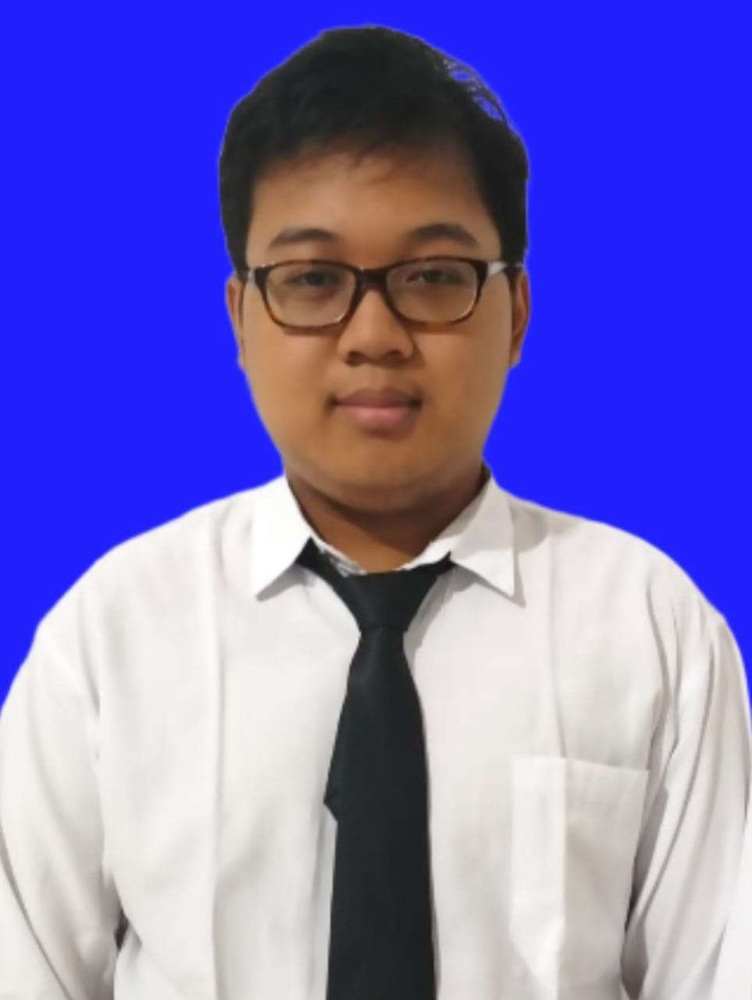

<!-- HEADER & BACKGROUND -->

  

<!-- FOTO PROFIL & BIO UTAMA -->

  

<h1 align="center">CURRICULUM VITAE</h1>
<h3 align="center">RayaSobarulMuttaqin</h3>

  <i>Student & Web Development Enthusiast</i> 
  📍 Indonesia

  
  

---

## PROFIL
Saya adalah seorang pembelajar yang berdedikasi dengan ketertarikan kuat di bidang pemrograman (*software development*) dan komunikasi bahasa Inggris. Berkomitmen untuk terus mengembangkan kemampuan logis dan pemecahan masalah melalui pemrograman dasar, serta siap beradaptasi dalam lingkungan kerja maupun akademik.

---

## 🎓 EDUCATION

### 🏫 Formal
* **SMA (Sekolah Menengah Atas)**
  * *Tahun:* 2021 – 2024

### 📜 Informal
* **Sertifikat Bahasa Inggris - Conversation 2**
  * *Lembaga:* [LPIA]
  * *Tahun:* 2026

---

## 🛠️ SKILL

* **Bahasa:**
  * 🇮🇩 Bahasa Indonesia (*Native*)
  * 🇬🇧 English (*Conversational / Lisan & Tulisan*)
* **Programming & Technical:**
  * Basic Programming Concepts (*Logika Pemrograman, Flow Control, Variabel*)
  * Basic Web Development (*HTML, CSS, PHP*)
  * Basic Database (*SQL / Relational Concepts*)
  * Version Control (*Git & GitHub*)

---

## EXPERIENCE

* **Fresh Graduate / Academic Focus**
  * *Berfokus pada pengembangan diri, studi akademik, serta latihan penulisan skrip dan logika pemrograman dasar.*

---

## PORTOFOLIO

1. **Sertifikat Kursus Conversation 2 Bahasa Inggris**
   * Bukti sertifikasi resmi kemampuan komunikasi bahasa Inggris tingkat lanjut (*Conversation 2*).

2. **Artikel & Publikasi CV di Blog**
   * Publikasi profil profesional dan penugasan akademik yang diunggah secara publik di halaman blog pribadi.
